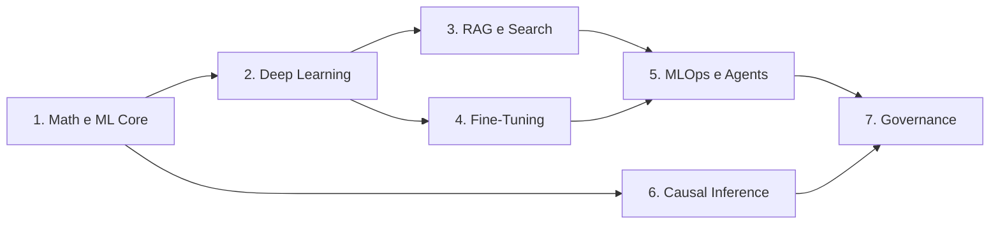

# Plano de Estudo — Enterprise AI Architect

Trilha completa de 32 semanas (cerca de 7 meses e meio a 14 horas por semana) para ir de Ciência de Dados a Arquitetura de IA Corporativa. Cada semana combina três peças:

1. **Fundamento e leitura de conceito:** um documento Markdown com os conceitos, as fórmulas, exemplos numéricos, erros comuns, as pontes para GenAI, o material externo recomendado e perguntas de autoavaliação. O texto é em português; termos técnicos, nomes de funções e de bibliotecas ficam em inglês, como são usados no mercado e na documentação.
2. **Notebook de exercícios para o Google Colab:** código com trechos marcados `# [SEU CÓDIGO AQUI]` para você completar.
3. **Notebook gabarito:** a mesma sequência, resolvida, para conferir depois de tentar.

## Como usar

### Rotina semanal

| Quando | O quê | Tempo |
|---|---|---|
| Sábado e domingo | Leitura de conceito da semana e o material externo indicado nela. Nenhuma linha de código. | ~4 h |
| Segunda a quinta | Notebook de exercícios no Colab, dois ou três passos por dia. | ~2 h/dia |
| Sexta | Terminar os passos, comparar com o gabarito, escrever o entregável em `docs/`, commit e registro no `LOGBOOK.md`. | ~2 h |

### O ciclo de cada semana

1. Leia `Semana-NN-Conceitos.md` e responda mentalmente às perguntas de autoavaliação.
2. Abra `semana_NN_exercicio.ipynb` no Colab e complete os trechos marcados, executando as células em ordem.
3. Só depois abra `semana_NN_gabarito.ipynb`. Compare as soluções; diferenças de estilo são normais, diferenças de resultado merecem investigação.
4. Produza o **entregável** descrito no fim da leitura (uma nota, tabela ou documento em `docs/`).
5. Commit. Na última semana de cada fase, confira o **checkpoint**.

### Abrindo os notebooks no Colab

Os selos "Open in Colab" abrem o arquivo direto do GitHub (`NetoRibeiro/ai-architect-foundations`, branch `main`), portanto funcionam depois do `git push`. Antes disso, use *Arquivo → Fazer upload de notebook* no Colab. Para salvar o seu trabalho de volta no repositório: *Arquivo → Salvar uma cópia no GitHub*.

A coluna **Ambiente** indica se a semana precisa de GPU. Quando indicar T4, selecione *Ambiente de execução → Alterar o tipo de ambiente de execução → T4 GPU* antes de executar.

## As sete fases

| Fase | Semanas | Objetivo |
|---|---|---|
| [1. Math Foundations e ML Core](01-Phase-1-Math-and-ML-Core/README.md) | 1–4 | Recalibrar o ML clássico e construir a base matemática (vectors, gradients, tensors) sobre a qual todo o resto se apoia. |
| [2. Deep Learning e o Ecossistema Hugging Face](02-Phase-2-Deep-Learning/README.md) | 5–10 | Abrir a black box: treinar redes, implementar attention e um mini-GPT, e operar modelos reais pela biblioteca `transformers`. |
| [3. Advanced RAG, Search e Reranking](03-Phase-3-Advanced-RAG/README.md) | 11–16 | Projetar e avaliar retrieval systems: embeddings, vector databases, hybrid search, reranking, ranking metrics e RAG evaluation. |
| [4. Parameter-Efficient Fine-Tuning (PEFT)](04-Phase-4-Fine-Tuning/README.md) | 17–22 | Adaptar open-weight models a um domínio: instruction dataset, LoRA, QLoRA, evaluation e preference alignment. |
| [5. MLOps, Deployment e Agent-First Products](05-Phase-5-MLOps-and-Agents/README.md) | 23–26 | Levar para produção: model serving com latência controlada, experiment tracking, observability, guardrails e análises expostas para agents. |
| [6. Causal Inference e Experimentation](06-Phase-6-Causal-Inference/README.md) | 27–30 | Provar impacto de negócio: experiments e métodos quasi-experimentais em cenários com network effects e spillover. |
| [7. Governance e Engineering at Scale](07-Phase-7-Governance-and-Scale/README.md) | 31–32 | Escalar pela organização: decisões documentadas (RFCs, ADRs), reproducibility e a métrica certa (OEC). |



A Fase 6 depende apenas da Fase 1. Se uma oportunidade de trabalho exigir experimentação antes, ela pode ser antecipada.

## Trilha de Aprendizado Recomendada (4 Ciclos e Marcos Integradores)

Para evitar fadiga em 32 semanas lineares e consolidar a visão de arquitetura em produção, organize a execução em **4 ciclos com marcos entregáveis**:

1. **Ciclo 1 — Base Matemática, Decisão Orientada a Custo e PyTorch (Semanas 1–4):**
   - *Foco:* Cost-sensitive thresholding e calibração (Semana 1), geometria de embeddings e normalização L2 (Semana 2), estabilidade de gradientes (Semana 3) e Autograd/CUDA (Semana 4).
   - *Marco de saída:* Motor de busca vetorial em NumPy + estudo financeiro de custo de erro (`FP` vs `FN`) aplicado a guardrails e detecção de alucinações.
2. **Ciclo 2 — Anatomia dos LLMs e Ecossistema Hugging Face (Semanas 5–10):**
   - *Foco:* Training loop, tokenização, Self-Attention (causal vs. bidirecional), Mini-GPT e fine-tuning de encoder sem data leakage.
   - *Marco de saída:* Capacidade de mapear todos os shapes de uma camada Transformer, explicar o crescimento quadrático de contexto/KV-cache e escolher entre Encoder e Decoder.
3. **Ciclo 3 — Especialização Aplicada: RAG vs. Fine-Tuning (Semanas 11–22):**
   - *Ramo 3A — Search & RAG Avançado (Semanas 11–16):* HNSW, Vector DBs com **Document-Level ACL / RLS**, parsing de documentos reais (tabelas/PDFs), Hybrid Search (BM25 + Dense + RRF + Cross-Encoder), NDCG/MRR e Faithfulness.
   - *Ramo 3B — PEFT & Alinhamento (Semanas 17–22):* Curadoria JSONL sem leakage, LoRA do zero, PEFT, QLoRA 4-bit, avaliação econômica contra *few-shot/RAG* e DPO.
   - *Marco de saída:* Um ADR comparando *RAG vs. Fine-Tuning* sustentado por métricas medidas (NDCG, Faithfulness, latência e custo de GPU).
4. **Ciclo 4 — Produção, FinOps, Impacto Causal e Governança (Semanas 23–32):**
   - *Bloco Operacional (Semanas 23–26):* Serving, KV-cache & batching, roteamento de modelos (FinOps), MLflow, OpenTelemetry spans, guardrails calibrados, evaluation de trajetórias de agents e structured outputs.
   - *Bloco Causal (Semanas 27–30):* A/B clusterizado contra spillover, CUPED, SRM, DiD, PSM, IV (com *exclusion restriction* validada) e Synthetic Control. *(Pode ser antecipado logo após o Ciclo 1).*
   - *Bloco de Governança e Capstone (Semanas 31–32):* ADRs, RFCs, reprodutibilidade com um comando, definição de OEC (evitando métricas proxy enganosas) e **Projeto Final integrando pipeline, observability, segurança e medição de impacto**.

## Cronograma semana a semana

### Fase 1 — Math Foundations e ML Core

| Semana | Tema | Conceito | Exercício | Gabarito | Ambiente |
|---|---|---|---|---|---|
| 1 | Scikit-Learn Pipelines e o Accuracy Paradox | [leitura](01-Phase-1-Math-and-ML-Core/01-sklearn-pipelines/docs/Semana-01-Conceitos.md) | [](https://colab.research.google.com/github/NetoRibeiro/ai-architect-foundations/blob/main/01-Phase-1-Math-and-ML-Core/01-sklearn-pipelines/notebooks/semana_01_exercicio.ipynb) | [](https://colab.research.google.com/github/NetoRibeiro/ai-architect-foundations/blob/main/01-Phase-1-Math-and-ML-Core/01-sklearn-pipelines/notebooks/semana_01_gabarito.ipynb) | CPU |
| 2 | A Geometria dos Dados: Linear Algebra com NumPy | [leitura](01-Phase-1-Math-and-ML-Core/02-linear-algebra-numpy/docs/Semana-02-Conceitos.md) | [](https://colab.research.google.com/github/NetoRibeiro/ai-architect-foundations/blob/main/01-Phase-1-Math-and-ML-Core/02-linear-algebra-numpy/notebooks/semana_02_exercicio.ipynb) | [](https://colab.research.google.com/github/NetoRibeiro/ai-architect-foundations/blob/main/01-Phase-1-Math-and-ML-Core/02-linear-algebra-numpy/notebooks/semana_02_gabarito.ipynb) | CPU |
| 3 | O Motor do Aprendizado: Calculus e Gradient Descent | [leitura](01-Phase-1-Math-and-ML-Core/03-calculus-gradient/docs/Semana-03-Conceitos.md) | [](https://colab.research.google.com/github/NetoRibeiro/ai-architect-foundations/blob/main/01-Phase-1-Math-and-ML-Core/03-calculus-gradient/notebooks/semana_03_exercicio.ipynb) | [](https://colab.research.google.com/github/NetoRibeiro/ai-architect-foundations/blob/main/01-Phase-1-Math-and-ML-Core/03-calculus-gradient/notebooks/semana_03_gabarito.ipynb) | CPU |
| 4 | A Ponte para Tensors: PyTorch e Autograd | [leitura](01-Phase-1-Math-and-ML-Core/04-pytorch-tensors/docs/Semana-04-Conceitos.md) | [](https://colab.research.google.com/github/NetoRibeiro/ai-architect-foundations/blob/main/01-Phase-1-Math-and-ML-Core/04-pytorch-tensors/notebooks/semana_04_exercicio.ipynb) | [](https://colab.research.google.com/github/NetoRibeiro/ai-architect-foundations/blob/main/01-Phase-1-Math-and-ML-Core/04-pytorch-tensors/notebooks/semana_04_gabarito.ipynb) | T4 |

### Fase 2 — Deep Learning e o Ecossistema Hugging Face

| Semana | Tema | Conceito | Exercício | Gabarito | Ambiente |
|---|---|---|---|---|---|
| 5 | O Training Loop: nn.Module, DataLoader e MLP | [leitura](02-Phase-2-Deep-Learning/docs/Semana-05-Conceitos.md) | [](https://colab.research.google.com/github/NetoRibeiro/ai-architect-foundations/blob/main/02-Phase-2-Deep-Learning/notebooks/semana_05_exercicio.ipynb) | [](https://colab.research.google.com/github/NetoRibeiro/ai-architect-foundations/blob/main/02-Phase-2-Deep-Learning/notebooks/semana_05_gabarito.ipynb) | CPU |
| 6 | Tokenization, Embeddings e um Bigram Language Model | [leitura](02-Phase-2-Deep-Learning/docs/Semana-06-Conceitos.md) | [](https://colab.research.google.com/github/NetoRibeiro/ai-architect-foundations/blob/main/02-Phase-2-Deep-Learning/notebooks/semana_06_exercicio.ipynb) | [](https://colab.research.google.com/github/NetoRibeiro/ai-architect-foundations/blob/main/02-Phase-2-Deep-Learning/notebooks/semana_06_gabarito.ipynb) | CPU |
| 7 | Self-Attention do Zero | [leitura](02-Phase-2-Deep-Learning/docs/Semana-07-Conceitos.md) | [](https://colab.research.google.com/github/NetoRibeiro/ai-architect-foundations/blob/main/02-Phase-2-Deep-Learning/notebooks/semana_07_exercicio.ipynb) | [](https://colab.research.google.com/github/NetoRibeiro/ai-architect-foundations/blob/main/02-Phase-2-Deep-Learning/notebooks/semana_07_gabarito.ipynb) | CPU |
| 8 | Montando um Mini-GPT | [leitura](02-Phase-2-Deep-Learning/docs/Semana-08-Conceitos.md) | [](https://colab.research.google.com/github/NetoRibeiro/ai-architect-foundations/blob/main/02-Phase-2-Deep-Learning/notebooks/semana_08_exercicio.ipynb) | [](https://colab.research.google.com/github/NetoRibeiro/ai-architect-foundations/blob/main/02-Phase-2-Deep-Learning/notebooks/semana_08_gabarito.ipynb) | T4 |
| 9 | Hugging Face por Dentro: Tokenizers, Hidden States e Generation | [leitura](02-Phase-2-Deep-Learning/docs/Semana-09-Conceitos.md) | [](https://colab.research.google.com/github/NetoRibeiro/ai-architect-foundations/blob/main/02-Phase-2-Deep-Learning/notebooks/semana_09_exercicio.ipynb) | [](https://colab.research.google.com/github/NetoRibeiro/ai-architect-foundations/blob/main/02-Phase-2-Deep-Learning/notebooks/semana_09_gabarito.ipynb) | T4 |
| 10 | Projeto: Fine-Tuning de um Encoder com Training Loop Manual | [leitura](02-Phase-2-Deep-Learning/docs/Semana-10-Conceitos.md) | [](https://colab.research.google.com/github/NetoRibeiro/ai-architect-foundations/blob/main/02-Phase-2-Deep-Learning/notebooks/semana_10_exercicio.ipynb) | [](https://colab.research.google.com/github/NetoRibeiro/ai-architect-foundations/blob/main/02-Phase-2-Deep-Learning/notebooks/semana_10_gabarito.ipynb) | T4 |

### Fase 3 — Advanced RAG, Search e Reranking

| Semana | Tema | Conceito | Exercício | Gabarito | Ambiente |
|---|---|---|---|---|---|
| 11 | Embeddings e Semantic Search (Exact vs. HNSW) | [leitura](03-Phase-3-Advanced-RAG/docs/Semana-11-Conceitos.md) | [](https://colab.research.google.com/github/NetoRibeiro/ai-architect-foundations/blob/main/03-Phase-3-Advanced-RAG/notebooks/semana_11_exercicio.ipynb) | [](https://colab.research.google.com/github/NetoRibeiro/ai-architect-foundations/blob/main/03-Phase-3-Advanced-RAG/notebooks/semana_11_gabarito.ipynb) | T4 |
| 12 | Vector Databases: Qdrant, pgvector e Metadata Filtering | [leitura](03-Phase-3-Advanced-RAG/docs/Semana-12-Conceitos.md) | [](https://colab.research.google.com/github/NetoRibeiro/ai-architect-foundations/blob/main/03-Phase-3-Advanced-RAG/notebooks/semana_12_exercicio.ipynb) | [](https://colab.research.google.com/github/NetoRibeiro/ai-architect-foundations/blob/main/03-Phase-3-Advanced-RAG/notebooks/semana_12_gabarito.ipynb) | CPU |
| 13 | Chunking e o Primeiro RAG Pipeline | [leitura](03-Phase-3-Advanced-RAG/docs/Semana-13-Conceitos.md) | [](https://colab.research.google.com/github/NetoRibeiro/ai-architect-foundations/blob/main/03-Phase-3-Advanced-RAG/notebooks/semana_13_exercicio.ipynb) | [](https://colab.research.google.com/github/NetoRibeiro/ai-architect-foundations/blob/main/03-Phase-3-Advanced-RAG/notebooks/semana_13_gabarito.ipynb) | T4 |
| 14 | Hybrid Search e Multi-Stage Reranking | [leitura](03-Phase-3-Advanced-RAG/docs/Semana-14-Conceitos.md) | [](https://colab.research.google.com/github/NetoRibeiro/ai-architect-foundations/blob/main/03-Phase-3-Advanced-RAG/notebooks/semana_14_exercicio.ipynb) | [](https://colab.research.google.com/github/NetoRibeiro/ai-architect-foundations/blob/main/03-Phase-3-Advanced-RAG/notebooks/semana_14_gabarito.ipynb) | T4 |
| 15 | Ranking Metrics: Recall@K, MRR e NDCG | [leitura](03-Phase-3-Advanced-RAG/docs/Semana-15-Conceitos.md) | [](https://colab.research.google.com/github/NetoRibeiro/ai-architect-foundations/blob/main/03-Phase-3-Advanced-RAG/notebooks/semana_15_exercicio.ipynb) | [](https://colab.research.google.com/github/NetoRibeiro/ai-architect-foundations/blob/main/03-Phase-3-Advanced-RAG/notebooks/semana_15_gabarito.ipynb) | CPU |
| 16 | RAG Evaluation: Faithfulness, Context e Capstone | [leitura](03-Phase-3-Advanced-RAG/docs/Semana-16-Conceitos.md) | [](https://colab.research.google.com/github/NetoRibeiro/ai-architect-foundations/blob/main/03-Phase-3-Advanced-RAG/notebooks/semana_16_exercicio.ipynb) | [](https://colab.research.google.com/github/NetoRibeiro/ai-architect-foundations/blob/main/03-Phase-3-Advanced-RAG/notebooks/semana_16_gabarito.ipynb) | T4 |

### Fase 4 — Parameter-Efficient Fine-Tuning (PEFT)

| Semana | Tema | Conceito | Exercício | Gabarito | Ambiente |
|---|---|---|---|---|---|
| 17 | Instruction Dataset Engineering (JSONL) | [leitura](04-Phase-4-Fine-Tuning/docs/Semana-17-Conceitos.md) | [](https://colab.research.google.com/github/NetoRibeiro/ai-architect-foundations/blob/main/04-Phase-4-Fine-Tuning/notebooks/semana_17_exercicio.ipynb) | [](https://colab.research.google.com/github/NetoRibeiro/ai-architect-foundations/blob/main/04-Phase-4-Fine-Tuning/notebooks/semana_17_gabarito.ipynb) | CPU |
| 18 | LoRA do Zero: a Matemática do Low Rank | [leitura](04-Phase-4-Fine-Tuning/docs/Semana-18-Conceitos.md) | [](https://colab.research.google.com/github/NetoRibeiro/ai-architect-foundations/blob/main/04-Phase-4-Fine-Tuning/notebooks/semana_18_exercicio.ipynb) | [](https://colab.research.google.com/github/NetoRibeiro/ai-architect-foundations/blob/main/04-Phase-4-Fine-Tuning/notebooks/semana_18_gabarito.ipynb) | CPU |
| 19 | Fine-Tuning com PEFT/LoRA | [leitura](04-Phase-4-Fine-Tuning/docs/Semana-19-Conceitos.md) | [](https://colab.research.google.com/github/NetoRibeiro/ai-architect-foundations/blob/main/04-Phase-4-Fine-Tuning/notebooks/semana_19_exercicio.ipynb) | [](https://colab.research.google.com/github/NetoRibeiro/ai-architect-foundations/blob/main/04-Phase-4-Fine-Tuning/notebooks/semana_19_gabarito.ipynb) | T4 |
| 20 | QLoRA: 4-bit Quantization | [leitura](04-Phase-4-Fine-Tuning/docs/Semana-20-Conceitos.md) | [](https://colab.research.google.com/github/NetoRibeiro/ai-architect-foundations/blob/main/04-Phase-4-Fine-Tuning/notebooks/semana_20_exercicio.ipynb) | [](https://colab.research.google.com/github/NetoRibeiro/ai-architect-foundations/blob/main/04-Phase-4-Fine-Tuning/notebooks/semana_20_gabarito.ipynb) | T4 |
| 21 | Avaliando o Fine-Tuned Model | [leitura](04-Phase-4-Fine-Tuning/docs/Semana-21-Conceitos.md) | [](https://colab.research.google.com/github/NetoRibeiro/ai-architect-foundations/blob/main/04-Phase-4-Fine-Tuning/notebooks/semana_21_exercicio.ipynb) | [](https://colab.research.google.com/github/NetoRibeiro/ai-architect-foundations/blob/main/04-Phase-4-Fine-Tuning/notebooks/semana_21_gabarito.ipynb) | T4 |
| 22 | Preference Alignment: DPO do Zero | [leitura](04-Phase-4-Fine-Tuning/docs/Semana-22-Conceitos.md) | [](https://colab.research.google.com/github/NetoRibeiro/ai-architect-foundations/blob/main/04-Phase-4-Fine-Tuning/notebooks/semana_22_exercicio.ipynb) | [](https://colab.research.google.com/github/NetoRibeiro/ai-architect-foundations/blob/main/04-Phase-4-Fine-Tuning/notebooks/semana_22_gabarito.ipynb) | T4 |

### Fase 5 — MLOps, Deployment e Agent-First Products

| Semana | Tema | Conceito | Exercício | Gabarito | Ambiente |
|---|---|---|---|---|---|
| 23 | Model Serving: Latency, Throughput e Batching | [leitura](05-Phase-5-MLOps-and-Agents/docs/Semana-23-Conceitos.md) | [](https://colab.research.google.com/github/NetoRibeiro/ai-architect-foundations/blob/main/05-Phase-5-MLOps-and-Agents/notebooks/semana_23_exercicio.ipynb) | [](https://colab.research.google.com/github/NetoRibeiro/ai-architect-foundations/blob/main/05-Phase-5-MLOps-and-Agents/notebooks/semana_23_gabarito.ipynb) | T4 |
| 24 | Experiment Tracking e Model Registry com MLflow | [leitura](05-Phase-5-MLOps-and-Agents/docs/Semana-24-Conceitos.md) | [](https://colab.research.google.com/github/NetoRibeiro/ai-architect-foundations/blob/main/05-Phase-5-MLOps-and-Agents/notebooks/semana_24_exercicio.ipynb) | [](https://colab.research.google.com/github/NetoRibeiro/ai-architect-foundations/blob/main/05-Phase-5-MLOps-and-Agents/notebooks/semana_24_gabarito.ipynb) | CPU |
| 25 | Observability e Guardrails | [leitura](05-Phase-5-MLOps-and-Agents/docs/Semana-25-Conceitos.md) | [](https://colab.research.google.com/github/NetoRibeiro/ai-architect-foundations/blob/main/05-Phase-5-MLOps-and-Agents/notebooks/semana_25_exercicio.ipynb) | [](https://colab.research.google.com/github/NetoRibeiro/ai-architect-foundations/blob/main/05-Phase-5-MLOps-and-Agents/notebooks/semana_25_gabarito.ipynb) | CPU |
| 26 | Agent-First Analytics: Structured Outputs para Agents | [leitura](05-Phase-5-MLOps-and-Agents/docs/Semana-26-Conceitos.md) | [](https://colab.research.google.com/github/NetoRibeiro/ai-architect-foundations/blob/main/05-Phase-5-MLOps-and-Agents/notebooks/semana_26_exercicio.ipynb) | [](https://colab.research.google.com/github/NetoRibeiro/ai-architect-foundations/blob/main/05-Phase-5-MLOps-and-Agents/notebooks/semana_26_gabarito.ipynb) | CPU |

### Fase 6 — Causal Inference e Experimentation

| Semana | Tema | Conceito | Exercício | Gabarito | Ambiente |
|---|---|---|---|---|---|
| 27 | A/B Tests, Statistical Power e Spillover em Redes | [leitura](06-Phase-6-Causal-Inference/docs/Semana-27-Conceitos.md) | [](https://colab.research.google.com/github/NetoRibeiro/ai-architect-foundations/blob/main/06-Phase-6-Causal-Inference/notebooks/semana_27_exercicio.ipynb) | [](https://colab.research.google.com/github/NetoRibeiro/ai-architect-foundations/blob/main/06-Phase-6-Causal-Inference/notebooks/semana_27_gabarito.ipynb) | CPU |
| 28 | Difference-in-Differences (DiD) | [leitura](06-Phase-6-Causal-Inference/docs/Semana-28-Conceitos.md) | [](https://colab.research.google.com/github/NetoRibeiro/ai-architect-foundations/blob/main/06-Phase-6-Causal-Inference/notebooks/semana_28_exercicio.ipynb) | [](https://colab.research.google.com/github/NetoRibeiro/ai-architect-foundations/blob/main/06-Phase-6-Causal-Inference/notebooks/semana_28_gabarito.ipynb) | CPU |
| 29 | Propensity Score Matching e Instrumental Variables | [leitura](06-Phase-6-Causal-Inference/docs/Semana-29-Conceitos.md) | [](https://colab.research.google.com/github/NetoRibeiro/ai-architect-foundations/blob/main/06-Phase-6-Causal-Inference/notebooks/semana_29_exercicio.ipynb) | [](https://colab.research.google.com/github/NetoRibeiro/ai-architect-foundations/blob/main/06-Phase-6-Causal-Inference/notebooks/semana_29_gabarito.ipynb) | CPU |
| 30 | Synthetic Control | [leitura](06-Phase-6-Causal-Inference/docs/Semana-30-Conceitos.md) | [](https://colab.research.google.com/github/NetoRibeiro/ai-architect-foundations/blob/main/06-Phase-6-Causal-Inference/notebooks/semana_30_exercicio.ipynb) | [](https://colab.research.google.com/github/NetoRibeiro/ai-architect-foundations/blob/main/06-Phase-6-Causal-Inference/notebooks/semana_30_gabarito.ipynb) | CPU |

### Fase 7 — Governance e Engineering at Scale

| Semana | Tema | Conceito | Exercício | Gabarito | Ambiente |
|---|---|---|---|---|---|
| 31 | RFCs, ADRs e Reproducibility com um Comando | [leitura](07-Phase-7-Governance-and-Scale/docs/Semana-31-Conceitos.md) | [](https://colab.research.google.com/github/NetoRibeiro/ai-architect-foundations/blob/main/07-Phase-7-Governance-and-Scale/notebooks/semana_31_exercicio.ipynb) | [](https://colab.research.google.com/github/NetoRibeiro/ai-architect-foundations/blob/main/07-Phase-7-Governance-and-Scale/notebooks/semana_31_gabarito.ipynb) | CPU |
| 32 | OEC: a Métrica Certa e o Capstone Final | [leitura](07-Phase-7-Governance-and-Scale/docs/Semana-32-Conceitos.md) | [](https://colab.research.google.com/github/NetoRibeiro/ai-architect-foundations/blob/main/07-Phase-7-Governance-and-Scale/notebooks/semana_32_exercicio.ipynb) | [](https://colab.research.google.com/github/NetoRibeiro/ai-architect-foundations/blob/main/07-Phase-7-Governance-and-Scale/notebooks/semana_32_gabarito.ipynb) | CPU |

## Onde entrou cada ideia do seu rascunho

| Ideia | Onde está |
|---|---|
| Guia da Fase 1 (sklearn, álgebra linear, cálculo, PyTorch) | Semanas 1 a 4, mantendo os temas e os passos que você definiu |
| Laboratório de fraude com `class_weight` | Semana 1, ampliado com limiar de decisão e custo de negócio |
| Search, Recommendation e Reranking (NDCG, MRR, Recall@K, funil multi-estágio) | Semana 14 (funil, BM25, RRF, cross-encoder, entendimento da consulta) e Semana 15 (métricas) |
| Agent-First Analytics e AI Workflows | Semana 26 |
| Testes A/B em redes e randomização por cluster | Semana 27 |
| Diff-in-Diff com spillover (SP × RJ) | Semana 28 |
| Propensity Score Matching (app de fitness) e Variáveis Instrumentais (distância até a sala) | Semana 29 |
| Controle Sintético (lançamento na Espanha) | Semana 30 |
| RFCs, ADRs e reprodutibilidade com MLflow | Semana 24 (MLflow e Model Registry) e Semana 31 (ADR, RFC, um comando) |
| OEC e a proxy enganosa | Semana 32 |

No rascunho a governança aparecia como "Fase 7" sem uma Fase 6; a Inferência Causal ocupou esse lugar.

## Modelos e bibliotecas usados

Todos abertos e sem necessidade de chave de API ou aceite de licença:

| Uso | Modelo |
|---|---|
| Geração e fine-tuning | `Qwen/Qwen2.5-0.5B-Instruct`, `Qwen/Qwen2.5-1.5B-Instruct`, `distilgpt2` |
| Embeddings (multilíngue) | `sentence-transformers/paraphrase-multilingual-MiniLM-L12-v2` |
| Reranking | `cross-encoder/mmarco-mMiniLMv2-L12-H384-v1` |
| Fidelidade (NLI) | `MoritzLaurer/mDeBERTa-v3-base-xnli-multilingual-nli-2mil7` |
| Classificação | `distilbert-base-uncased` |

Bibliotecas: NumPy, pandas, scikit-learn, PyTorch, `transformers`, `peft`, `bitsandbytes`, `sentence-transformers`, FAISS, Qdrant, `rank_bm25`, MLflow, Pydantic, statsmodels, SciPy. Cada notebook instala o que não vem no Colab na primeira célula.

Para trocar por um modelo maior (por exemplo, quando tiver uma A100), altere a constante `MODELO` no início do notebook.

## Estado de validação dos notebooks

- **Executados de ponta a ponta** (gabarito): Semanas 1 a 8, 12 (exceto a célula opcional de pgvector), 15, 17, 18, 24 a 32.
- **Executados com modelos mínimos substitutos**, o que valida o código mas não a qualidade dos resultados: Semanas 9, 11, 13, 14, 16, 19, 21, 22 e 23. Na primeira execução real na T4, tempos e números serão diferentes dos esperados em um modelo de brinquedo; se alguma célula falhar por mudança de versão de biblioteca, o ajuste costuma ser pontual.
- **Somente verificação de sintaxe:** Semana 10 (depende do download do dataset AG News) e a Parte B da Semana 20 (QLoRA com `bitsandbytes`, que exige GPU CUDA).

## Convenções do repositório

```
NN-Phase-N-.../
├── README.md                          # índice da fase
├── docs/
│   ├── Semana-NN-Conceitos.md         # leitura de conceito
│   └── (seus entregáveis)
└── notebooks/
    ├── semana_NN_exercicio.ipynb
    └── semana_NN_gabarito.ipynb
```

Na Fase 1, `docs/` e `notebooks/` ficam dentro da subpasta de cada semana, como você já havia estruturado. Modelos de ADR e RFC estão em `07-Phase-7-Governance-and-Scale/docs/templates/`.

## Acompanhamento

- [ ] Semana 1 — Scikit-Learn Pipelines e o Accuracy Paradox
- [ ] Semana 2 — A Geometria dos Dados: Linear Algebra com NumPy
- [ ] Semana 3 — O Motor do Aprendizado: Calculus e Gradient Descent
- [ ] Semana 4 — A Ponte para Tensors: PyTorch e Autograd
- [ ] Semana 5 — O Training Loop: nn.Module, DataLoader e MLP
- [ ] Semana 6 — Tokenization, Embeddings e um Bigram Language Model
- [ ] Semana 7 — Self-Attention do Zero
- [ ] Semana 8 — Montando um Mini-GPT
- [ ] Semana 9 — Hugging Face por Dentro: Tokenizers, Hidden States e Generation
- [ ] Semana 10 — Projeto: Fine-Tuning de um Encoder com Training Loop Manual
- [ ] Semana 11 — Embeddings e Semantic Search (Exact vs. HNSW)
- [ ] Semana 12 — Vector Databases: Qdrant, pgvector e Metadata Filtering
- [ ] Semana 13 — Chunking e o Primeiro RAG Pipeline
- [ ] Semana 14 — Hybrid Search e Multi-Stage Reranking
- [ ] Semana 15 — Ranking Metrics: Recall@K, MRR e NDCG
- [ ] Semana 16 — RAG Evaluation: Faithfulness, Context e Capstone
- [ ] Semana 17 — Instruction Dataset Engineering (JSONL)
- [ ] Semana 18 — LoRA do Zero: a Matemática do Low Rank
- [ ] Semana 19 — Fine-Tuning com PEFT/LoRA
- [ ] Semana 20 — QLoRA: 4-bit Quantization
- [ ] Semana 21 — Avaliando o Fine-Tuned Model
- [ ] Semana 22 — Preference Alignment: DPO do Zero
- [ ] Semana 23 — Model Serving: Latency, Throughput e Batching
- [ ] Semana 24 — Experiment Tracking e Model Registry com MLflow
- [ ] Semana 25 — Observability e Guardrails
- [ ] Semana 26 — Agent-First Analytics: Structured Outputs para Agents
- [ ] Semana 27 — A/B Tests, Statistical Power e Spillover em Redes
- [ ] Semana 28 — Difference-in-Differences (DiD)
- [ ] Semana 29 — Propensity Score Matching e Instrumental Variables
- [ ] Semana 30 — Synthetic Control
- [ ] Semana 31 — RFCs, ADRs e Reproducibility com um Comando
- [ ] Semana 32 — OEC: a Métrica Certa e o Capstone Final
- [ ] Projeto final (descrito na leitura da Semana 32)
