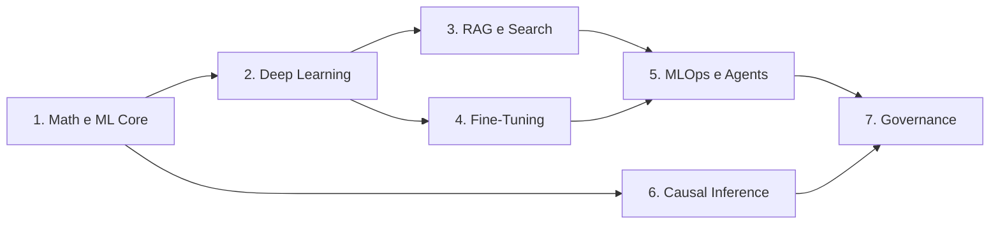

# Applied AI Architecture (Enterprise AI Architect — Foundations)

Repositório aberto de engenharia aplicada e trilha de estudos de **32 semanas (4 ciclos)** para evoluir de Ciência de Dados e Engenharia de Software para **Arquitetura de IA Corporativa**: da matemática por trás dos LLMs até RAG avançado, fine-tuning (LoRA/QLoRA/DPO), MLOps, FinOps, inferência causal e governança em produção.

Este projeto cumpre dois papéis simultâneos:
1. **Material aberto para qualquer pessoa estudar e executar na prática:** notebooks gratuitos no Google Colab (CPU/T4), leituras conceituais completas e um **Website Interativo (Workbench)** com simuladores matemáticos, comparador *Exercício vs. Gabarito*, templates de ADR/RFC e **LogBook passo a passo**.
2. **Estrutura de Portfólio de Engenharia Aplicada:** espaço pronto para documentar entregáveis reais (`docs/`), decisões arquiteturais (ADRs/RFCs), métricas medidas e evolução semanal no `LOGBOOK.md`.

> **English speakers:** this is a free, self-paced 32-week study track and interactive workbench from Data Science to Enterprise AI Architecture. Explanations are written in Portuguese, with technical terms, function names, and libraries kept in English. Notebooks run on Google Colab.

[](https://colab.research.google.com/github/NetoRibeiro/applied-ai-architecture/blob/main/01-Phase-1-Math-and-ML-Core/01-sklearn-pipelines/notebooks/semana_01_exercicio.ipynb)

## Portfólio de Entregáveis & Decisões de Arquitetura

Quem utiliza este repositório (seja como referência de estudo ou como fork pessoal) pode registrar aqui os principais marcos práticos concluídos ao longo dos 4 ciclos:

| Ciclo | Entregável Chave | Foco Técnico | Status |
|---|---|---|---|
| **Ciclo 1 (Sem. 1–4)** | Análise financeira de *threshold* + mini vector DB em NumPy | Cost-sensitive ML (`FP` vs `FN`), Cosine Similarity, Gradient Descent, Autograd | `[ ]` Em progresso |
| **Ciclo 2 (Sem. 5–10)** | Mini-GPT do zero + fine-tuning de encoder sem *data leakage* | Training loop, Self-Attention causal/bidirecional, Hugging Face `transformers` | `[ ]` A iniciar |
| **Ciclo 3A (Sem. 11–16)** | Pipeline Hybrid Search (BM25 + Dense + Reranker) avaliado | Vector DB com ACL/RLS, Recall@K, MRR, NDCG e Faithfulness | `[ ]` A iniciar |
| **Ciclo 3B (Sem. 17–22)** | ADR *RAG vs. Fine-Tuning* com QLoRA 4-bit e DPO | JSONL curation, LoRA do zero, PEFT, trade-off custo × qualidade | `[ ]` A iniciar |
| **Ciclo 4 (Sem. 23–32)** | Projeto Final + ADRs/RFCs + Experimento & OEC | Serving/KV-cache, FinOps, OpenTelemetry, Guardrails, Causal Inference | `[ ]` A iniciar |

## Como usar o Website Interativo (Workbench)

Além de navegar pelos arquivos no GitHub e executar os notebooks no Google Colab, você pode iniciar a aplicação web local (Node.js + React + Express):

```bash
npm install
npm run dev
```

O servidor inicia na porta `3000` e oferece cinco áreas integradas:

- **Currículo:** matriz visual das 32 semanas, filtros pelos 4 ciclos da trilha e busca textual completa nas leituras.
- **Leitura & Notebooks:** leitor editorial dos `Semana-NN-Conceitos.md` com comparador célula a célula (`# [SEU CÓDIGO AQUI]` vs. gabarito) e links diretos para o Colab.
- **Labs Interativos:** 5 simuladores no navegador replicando a matemática dos notebooks (Threshold & Custo, Vetores & Cosine Similarity, Gradient Descent, Recall@K/MRR/NDCG e LLM Serving/KV-Cache).
- **LogBook:** controle dos **6 passos semanais** em todas as 32 semanas (192 passos), registro de horas, entregáveis, travamentos, diário cronológico de comandos e exportação direta para `LOGBOOK.md` e checklist.
- **Governança:** editores Markdown com pré-visualização ao vivo baseados nos templates oficiais de ADR e RFC da Fase 7, sincronizados na nuvem.
- **Conta & Controle de Acesso:** login via Google (Firebase Auth), persistência por usuário no Firestore e painel administrativo para aprovar, suspender ou gerenciar papéis de acesso.

### Deploy via Docker na VPS / EasyPanel (e setup para forks)

Como `firebase-applet-config.json`, `firestore.rules` e `.env` ficam no `.gitignore`, o build Docker funciona mesmo sem esses arquivos no repositório. Para habilitar o login Google e o banco Firestore na sua VPS/EasyPanel:

**Opção A — EasyPanel (variáveis de ambiente em runtime):**
1. Conecte o repositório usando o `Dockerfile`.
2. Na aba **Environment / .env** do EasyPanel, adicione:
   ```env
   VITE_ADMIN_EMAIL=seu-email-admin@exemplo.com
   FIREBASE_CONFIG_JSON={"projectId":"...","appId":"...","apiKey":"...","authDomain":"...","firestoreDatabaseId":"(default)"}
   ```
3. Publique as regras de `firestore.rules.example` (substituindo `admin@exemplo.com` pelo seu e-mail) no projeto Firebase e adicione o domínio do EasyPanel em **Firebase Console → Authentication → Settings → Authorized domains**.

**Opção B — Docker Compose direto na VPS:**
```bash
cp .env.example .env
cp firebase-applet-config.example.json firebase-applet-config.json
cp firestore.rules.example firestore.rules
docker compose up -d --build
```

## Para quem é

- Data scientists, data analysts e data engineers que querem trabalhar com LLMs além da chamada de API.
- Pessoas de software que querem a base de ML e de avaliação que falta para projetar sistemas de IA.
- Quem já usa RAG ou fine-tuning e quer entender o que acontece por baixo.

### O que você precisa saber antes

| Pré-requisito | Nível |
|---|---|
| Python | Confortável com funções, classes, listas e dicionários |
| pandas e NumPy | Uso básico |
| Machine Learning clássico | Já treinou um modelo com scikit-learn e sabe o que é train/test split |
| Matemática | Ensino médio; a Fase 1 reconstrói álgebra linear e cálculo do zero |
| Inglês | Leitura técnica (os termos e as referências estão em inglês) |

Se algum item estiver fraco, comece mesmo assim: a Semana 1 é uma revisão de ML clássico.

### O que você precisa ter

- Uma conta Google, para usar o [Google Colab](https://colab.research.google.com/). Os notebooks foram dimensionados para a GPU T4 do plano gratuito; o Colab Pro só deixa as semanas de fine-tuning mais confortáveis.
- Uma conta no GitHub, para guardar o seu progresso (recomendado).
- Cerca de **14 horas por semana**. Em outro ritmo, a trilha funciona igual: só leva mais ou menos tempo.

Nenhuma chave de API é necessária. Todos os modelos usados são abertos e baixados direto do Hugging Face Hub.

## Como começar

### 1. Faça um fork

Clique em **Fork** no topo desta página. O fork é o seu caderno de estudos: nele você salva os notebooks resolvidos e escreve os entregáveis de cada semana.

Se só quiser experimentar, pule este passo e abra os notebooks direto pelos selos "Open in Colab".

### 2. Leia o plano

O [**PLANO_DE_ESTUDO.md**](PLANO_DE_ESTUDO.md) tem o cronograma das 32 semanas, com link para a leitura e para os notebooks de cada uma.

### 3. Abra a Semana 1

- Leitura: [Semana 1 — Scikit-Learn Pipelines e o Accuracy Paradox](01-Phase-1-Math-and-ML-Core/01-sklearn-pipelines/docs/Semana-01-Conceitos.md)
- Notebook: use o selo no topo desta página.

### 4. Salve o seu trabalho

No Colab: **Arquivo → Salvar uma cópia no GitHub** e escolha o seu fork. Os selos "Open in Colab" dentro dos notebooks apontam para este repositório original; para reabrir a **sua** versão, use **Arquivo → Abrir notebook → GitHub** no Colab e selecione o seu fork.

## Como funciona cada semana

Cada semana tem três peças:

| Peça | Arquivo | Para quê |
|---|---|---|
| Leitura de conceito | `docs/Semana-NN-Conceitos.md` | Conceitos, fórmulas, exemplos numéricos, erros comuns, referências e perguntas de autoavaliação |
| Notebook de exercícios | `notebooks/semana_NN_exercicio.ipynb` | Código com trechos marcados `# [SEU CÓDIGO AQUI]` para você completar |
| Notebook gabarito | `notebooks/semana_NN_gabarito.ipynb` | A mesma sequência resolvida, para conferir **depois** de tentar |

O ciclo:

1. **Leia** a leitura de conceito e o material externo indicado nela. Sem código.
2. **Responda** às perguntas de autoavaliação, de preferência por escrito.
3. **Resolva** o notebook de exercícios, executando as células em ordem.
4. **Compare** com o gabarito. Diferença de estilo é normal; diferença de resultado merece investigação.
5. **Escreva** o entregável da semana (uma nota, tabela ou documento curto em `docs/`).
6. **Faça commit** no seu fork e marque a semana como concluída.

### Rotina sugerida

| Quando | O quê | Tempo |
|---|---|---|
| Sábado e domingo | Leitura de conceito e material externo | ~4 h |
| Segunda a quinta | Notebook de exercícios, dois ou três passos por dia | ~2 h/dia |
| Sexta | Terminar, comparar com o gabarito, entregável e commit | ~2 h |

### Regras que fazem diferença

- **Tente antes de olhar o gabarito.** Travar por vinte minutos em um exercício ensina mais do que ler a solução em dois.
- **Não pule o entregável.** Escrever a conclusão com as suas palavras é o que fixa o conteúdo, e os entregáveis viram portfólio.
- **Não pule a Fase 1**, mesmo que pareça básica. As fases seguintes assumem dot product, gradient descent e o training loop na ponta dos dedos.
- **Respeite os checkpoints.** A última leitura de cada fase lista o que você deve conseguir explicar sem consultar. Se não conseguir, volte antes de avançar.

## A trilha

| Fase | Semanas | O que você constrói |
|---|---|---|
| [1. Math Foundations e ML Core](01-Phase-1-Math-and-ML-Core/README.md) | 1–4 | Pipeline com análise de custo por threshold; mini vector database em NumPy; gradient descent à mão; training loop em PyTorch |
| [2. Deep Learning e o Ecossistema Hugging Face](02-Phase-2-Deep-Learning/README.md) | 5–10 | MLP, bigram language model, self-attention do zero, um mini-GPT e o fine-tuning de um encoder |
| [3. Advanced RAG, Search e Reranking](03-Phase-3-Advanced-RAG/README.md) | 11–16 | Semantic search com HNSW, vector database com filtros, RAG pipeline, hybrid search com reranking e avaliação com NDCG e faithfulness |
| [4. Parameter-Efficient Fine-Tuning](04-Phase-4-Fine-Tuning/README.md) | 17–22 | Instruction dataset, LoRA do zero, fine-tuning com PEFT, QLoRA, avaliação contra few-shot e DPO |
| [5. MLOps, Deployment e Agent-First Products](05-Phase-5-MLOps-and-Agents/README.md) | 23–26 | Capacity planning de um serviço de LLM, experiment tracking com MLflow, tracing e guardrails, tools para agents |
| [6. Causal Inference e Experimentation](06-Phase-6-Causal-Inference/README.md) | 27–30 | A/B tests com spillover, Difference-in-Differences, Propensity Score Matching, Instrumental Variables e Synthetic Control |
| [7. Governance e Engineering at Scale](07-Phase-7-Governance-and-Scale/README.md) | 31–32 | ADR e RFC, reprodução com um comando, um OEC validado e o projeto final |



### Organização recomendada em 4 ciclos (Marcos Integradores)

Para evitar fadiga em 32 semanas lineares e consolidar a visão de arquitetura em produção, a trilha é organizada em **4 ciclos com marcos entregáveis** (detalhados no [`PLANO_DE_ESTUDO.md`](PLANO_DE_ESTUDO.md)):

| Ciclo | Semanas | Foco e Marco Integrador |
|---|---|---|
| **Ciclo 1 — Base Matemática & PyTorch** | 1–4 | Cost-sensitive thresholding e calibração, geometria vetorial e normalização L2, estabilidade de gradientes e Autograd/CUDA. **Marco:** motor de busca vetorial em NumPy + estudo financeiro de custo de erro (`FP` vs `FN`). |
| **Ciclo 2 — Anatomia dos LLMs** | 5–10 | Training loop, tokenização, Self-Attention (causal vs. bidirecional), Mini-GPT e fine-tuning de encoder sem data leakage. **Marco:** mapear todos os shapes do Transformer e decidir entre Encoder e Decoder. |
| **Ciclo 3 — RAG & PEFT (Especialização)** | 11–22 | **Ramo 3A (11–16):** HNSW, Vector DBs com **Document-Level ACL / RLS**, parsing real de PDFs/tabelas, Hybrid Search + Reranking, NDCG e Faithfulness. **Ramo 3B (17–22):** JSONL sem leakage, LoRA, QLoRA, avaliação econômica vs. few-shot/RAG e DPO. **Marco:** ADR comparando *RAG vs. Fine-Tuning* com métricas medidas. |
| **Ciclo 4 — Produção, FinOps, Causal & Governança** | 23–32 | Serving/KV-cache, roteamento de modelos (FinOps), MLflow, OpenTelemetry spans, guardrails calibrados, evaluation de trajetórias de agents, A/B clusterizado/CUPED/DiD/PSM/IV/Synthetic Control, ADRs/RFCs e OEC. *(A Fase 6 — Semanas 27–30 — pode ser antecipada logo após o Ciclo 1)*. **Marco:** Capstone final reproduzível de ponta a ponta. |

### Atalhos possíveis

A ordem recomendada segue os ciclos acima. Se o seu objetivo imediato for mais estreito:

| Objetivo | Caminho mínimo |
|---|---|
| Construir e avaliar RAG | Fase 1 → Semanas 6, 7 e 9 → Fase 3 |
| Fine-tuning de open-weight models | Fases 1 e 2 → Fase 4 |
| Experimentação e causal inference | Semana 1 → Fase 6 → Semana 32 |
| Levar um sistema de LLM para produção | Fases 1 a 3 → Fase 5 → Fase 7 |

O projeto final, descrito na [leitura da Semana 32](07-Phase-7-Governance-and-Scale/docs/Semana-32-Conceitos.md), junta todas as fases em um sistema pequeno e documentado.

> **Nota sobre rascunhos históricos:** Os arquivos `Plano de Estudo Completo`, `Phase_01.md`, `01-Phase-1-Math-and-ML-Core/Phase-1.md` e `ROADMAP.md` foram preservados como rascunhos iniciais revisados (com notas de correção conceitual). O guia autoritativo das 32 semanas é o [`PLANO_DE_ESTUDO.md`](PLANO_DE_ESTUDO.md).

## Estrutura do repositório

```
applied-ai-architecture/
├── README.md                    # este guia
├── PLANO_DE_ESTUDO.md           # cronograma autoritativo das 32 semanas e 4 ciclos
├── LOGBOOK.md                   # registro cronológico de comandos e estudo
├── server.ts                    # servidor Express + API do currículo/notebooks
├── src/                         # aplicação web interativa (React + TypeScript + Tailwind)
├── 01-Phase-1-Math-and-ML-Core/
│   ├── README.md                # índice da fase
│   └── 01-sklearn-pipelines/    # na Fase 1, uma subpasta por semana
│       ├── docs/                # leitura de conceito e os seus entregáveis
│       └── notebooks/           # exercício e gabarito
├── 02-Phase-2-Deep-Learning/    # das Fases 2 a 7, docs/ e notebooks/ direto na fase
│   ├── README.md
│   ├── docs/
│   └── notebooks/
├── ...
└── 07-Phase-7-Governance-and-Scale/
    └── docs/templates/          # modelos de ADR e de RFC
```

## Stack

| Área | Ferramentas |
|---|---|
| Base | Python, NumPy, pandas, scikit-learn, SciPy, statsmodels |
| Deep Learning | PyTorch, Hugging Face `transformers`, `peft`, `bitsandbytes` |
| Retrieval | `sentence-transformers`, FAISS, Qdrant, pgvector, `rank_bm25` |
| MLOps | MLflow, Pydantic |
| Modelos | Qwen2.5 (0.5B e 1.5B), DistilGPT-2, DistilBERT, MiniLM multilingual |
| Workbench Web | Node.js 22, Express, React, TypeScript, Tailwind CSS |

Cada notebook instala, na primeira célula, o que não vem no Colab.

## Acompanhando o progresso

- **Pelo LogBook Interativo (Website):** marque cada um dos 6 passos semanais (*Leitura*, *Autoavaliação*, *Exercício*, *Gabarito*, *Entregável*, *Commit*), registre horas e travamentos e exporte seu `LOGBOOK.md` ou checklist em Markdown com um clique.
- **Diretamente no GitHub:** use a checklist no fim do [PLANO_DE_ESTUDO.md](PLANO_DE_ESTUDO.md) marcando cada semana com `[x]` e registre suas sessões no [LOGBOOK.md](LOGBOOK.md).
- Faça um commit por semana concluída. O histórico do fork vira a evidência da sua jornada.

## Perguntas frequentes

**Preciso do Colab Pro?**
Não. Os notebooks foram dimensionados para a GPU T4 do plano gratuito. O limite de uso desse plano pode interromper sessões longas nas Semanas 19 a 22; nesses casos, basta retomar depois.

**Quanto tempo leva?**
Cerca de sete meses e meio a 14 horas por semana. Com 7 horas por semana, o dobro.

**Posso rodar no meu computador?**
Sim. As semanas marcadas como CPU no plano rodam em qualquer máquina com Python. Para as marcadas como T4, o recomendável é uma GPU com 8 GB ou mais de VRAM.

**Uma célula deu erro. E agora?**
Primeiro confira se executou as células em ordem e, nas semanas com GPU, se o ambiente está em T4. As bibliotecas deste ecossistema mudam rápido; o [PLANO_DE_ESTUDO.md](PLANO_DE_ESTUDO.md) indica quais notebooks foram executados de ponta a ponta e quais só puderam ser validados com modelos substitutos. Se o erro persistir, abra uma issue com a semana, a célula e a mensagem.

**Por que o texto é em português e os termos em inglês?**
Porque é assim que eles aparecem na documentação, nos papers, nas vagas e no dia a dia. Aprender o termo original evita traduzir de volta depois.

## Contribuindo

Correções e melhorias são bem-vindas:

- **Issues:** erro em notebook, explicação confusa, link quebrado, sugestão de conteúdo.
- **Pull requests:** correções pontuais. Para mudanças maiores, abra uma issue antes para alinhar.

## Licença e Créditos

Distribuído sob a licença [Apache 2.0](LICENSE). Use, adapte, faça fork para o seu próprio portfólio e compartilhe com a comunidade, mantendo o aviso de licença.

---

*Currículo base criado por Neto Ribeiro ([`NetoRibeiro/applied-ai-architecture`](https://github.com/NetoRibeiro/applied-ai-architecture) · [LinkedIn](https://www.linkedin.com/in/netoribeiro/)), expandido com o Workbench Web Interativo, LogBook de 6 passos e revisão da trilha em 4 ciclos para estudo aberto e portfólio aplicado.*
